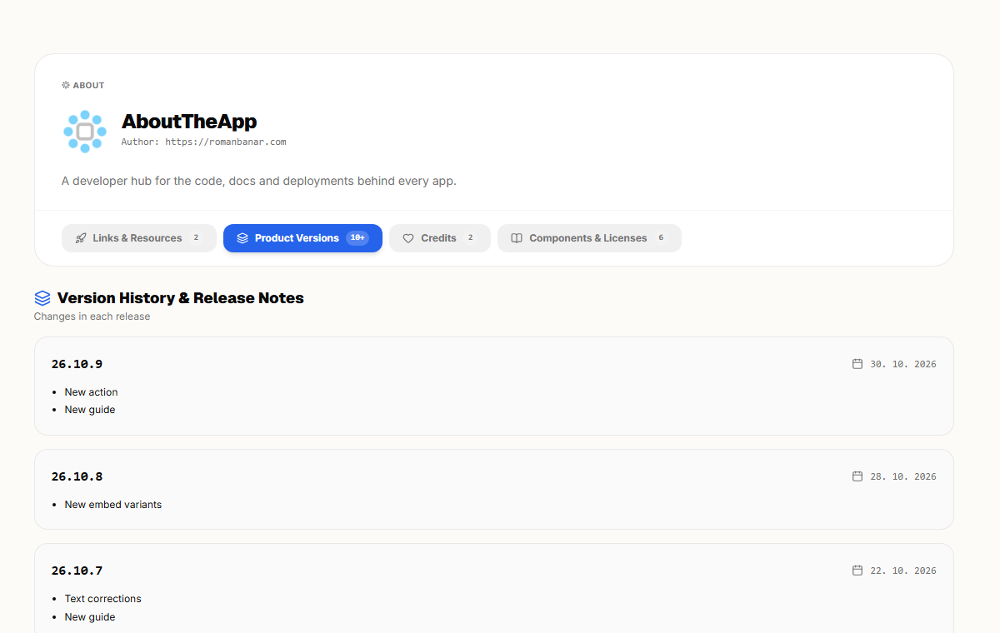

# AboutTheApp GitHub Action

Record app versions, release notes and deployments in [AboutTheApp](https://aboutthe.app) from your release workflow.

AboutTheApp keeps every link and resource of an app in one place: repositories, documentation, environments, support and third-party services. Your app can show them through a hosted About page, an embeddable About box or an API. This action keeps the version history and the record of what runs where up to date, so nobody has to maintain them by hand.



See the [live version history](https://aboutthe.app/aboutthe.app?tab=history) that this action writes for AboutTheApp itself.

You need an AboutTheApp account. The [Free plan](https://aboutthe.app/en/pricing) covers one app and includes this action.

The main action always registers the product version. When `customer-alias` and `environment` are supplied, it also records an installation of that version.

## Quick start

Create a CI/CD token in the AboutTheApp dashboard (user menu → Account → CI/CD; only the account owner can do this) and store it in the consuming repository as the `ABOUTTHEAPP_TOKEN` GitHub Actions secret.

```yaml
name: Report release

on:
  push:
    tags:
      - "v*"

permissions:
  contents: read

jobs:
  report:
    runs-on: ubuntu-latest
    steps:
      - uses: actions/checkout@v5
        with:
          fetch-depth: 0

      - name: Resolve release metadata
        id: release
        shell: bash
        run: |
          echo "version=${GITHUB_REF_NAME#v}" >> "$GITHUB_OUTPUT"
          previous_tag=$(git describe --tags --match 'v*' --abbrev=0 HEAD^ 2>/dev/null || true)
          echo "previous-tag=$previous_tag" >> "$GITHUB_OUTPUT"

      # Put this step after the steps that deploy your app, so only successful deployments are reported.
      - name: Report release to AboutTheApp
        uses: abouttheapp/sync@v1
        with:
          token: ${{ secrets.ABOUTTHEAPP_TOKEN }}
          alias: my-product
          version: ${{ steps.release.outputs.version }}
          changelog-source: git-log
          changelog-since: ${{ steps.release.outputs.previous-tag }}
          version-visibility: public
          customer-alias: acme
          environment: production
          url: https://app.example.com
          is-primary: true
```

A GitHub Release is not required. The example runs directly from a pushed Git tag.

## Set up with an AI agent

Paste this prompt into your coding agent (Claude Code, Codex, Cursor, Copilot) in the repository of your app and fill in the alias lines:

```text
Add the AboutTheApp GitHub Action to the deployment workflow of this repository.
Product alias: <alias>
Customer alias: <customer-alias>
Environment: production

Documentation: https://github.com/abouttheapp/sync#readme

1. Find the workflow that deploys this app. Add abouttheapp/sync@v1 as a step that runs after a successful deployment. Do not add it to test or pull request workflows. If no workflow deploys the app, stop and ask me.
2. Use the version the workflow already works with (Git tag, package.json, build number). Do not introduce a new versioning scheme.
3. Use changelog-source: git-log with changelog-since set to the previous release tag and make sure the checkout has fetch-depth: 0. If the repository has no release tags, use changelog-source: none.
4. Pass the token as ${{ secrets.ABOUTTHEAPP_TOKEN }}. Never write a token into a file. Tell me to add the secret, do not add it yourself.
5. If the workflow deploys to several environments, add one step per environment.
6. Change nothing else in the workflow and do not commit. When done, list what I have to check before the first run.
```

Things to know before the first run, for you and your agent:

- **The product and the customer must already exist in AboutTheApp.** The customer needs an alias. The action never creates them; a missing one fails with HTTP 404. The main action registers the version itself; only the separate `add-installation` action needs the version to exist.
- **One token per account.** It is shown only once and works for all products in the account. Generating a new one invalidates the previous one, so reuse it across repositories, for example as an organization secret.
- **Report only real deployments.** Every run with `customer-alias` and `environment` records a new installation event, including reruns. Add `verify-url` to record the installation only after the deployed app reports the new version, see [Verify the deployment](#verify-the-deployment).
- **New versions are private by default.** Add `version-visibility: public` to show them on the public About page.

## What the action records

The main action performs these operations in order:

1. If `verify-url` is present, wait until the deployed app reports the version.
2. Upsert the version and its changelog for the product identified by `alias`.
3. If both `customer-alias` and `environment` are present, append an installation event for that version.
4. If `sbom-file` is present, attach the SBOM to that version.

Version upserts are idempotent for the same product and version. Installations are intentionally append-only: rerunning a workflow with installation inputs records another installation event. The SBOM is uploaded last, so a rejected SBOM fails the step without preventing the version and the installation from being recorded.

## Attach an SBOM

With `sbom-file`, the action uploads a CycloneDX JSON SBOM (versions 1.4 to 1.7) to the version, so your team keeps the SBOM of every release in AboutTheApp. Generate the file in an earlier step with any CycloneDX tool, for example cdxgen, syft or Trivy:

```yaml
- name: Install dependencies
  run: npm ci

- name: Generate SBOM
  run: npx --yes @cyclonedx/cyclonedx-npm --output-file sbom.cdx.json

- uses: abouttheapp/sync@v1
  with:
    token: ${{ secrets.ABOUTTHEAPP_TOKEN }}
    alias: my-app
    version: ${{ github.ref_name }}
    sbom-file: sbom.cdx.json
    sbom-part: web
```

`@cyclonedx/cyclonedx-npm` reads the installed `node_modules`, so install the dependencies first. The file is compressed before the upload and may contain up to 10 MB of JSON. `sbom-part` names the part of the app the SBOM describes, for example `backend`, `web` or `ios`. Leave it empty for the whole app. A new SBOM of the same version and part replaces the previous one, which stays in the history. SBOMs are visible only to members of your workspace.

## Verify the deployment

With `verify-url`, the action checks the running app before it records anything. It requests the URL until the response reports the version being released, then records the version and the installation. If the app still reports another version or is unreachable when `verify-timeout` runs out, the step fails and nothing is recorded.

```yaml
with:
  customer-alias: acme
  environment: production
  version: 1.2.3
  verify-url: https://app.example.com/version.json
```

The URL must be reachable from the runner and answer with HTTP 2xx without authentication. Two response formats are supported:

- JSON such as `{"version": "1.2.3"}`. Use `verify-field` for another location, for example `.build.version`.
- Plain text whose first line is the version, for example `1.2.3`.

The reported value must match `version` exactly. Requests send `Cache-Control: no-cache` and follow redirects. Make sure a CDN does not serve the old response for longer than `verify-timeout`.

`verify-url` requires `customer-alias` and `environment` and is also available in the `add-installation` action.

## Changelog sources

Choose one of the following approaches:

### Git history

```yaml
with:
  changelog-source: git-log
  changelog-since: v1.2.2
```

The consuming workflow must check out the repository with `fetch-depth: 0`. An empty `changelog-since` reports the version without a changelog, which is useful for the first release.

### Keep a Changelog file

```yaml
with:
  version: 1.2.3
  changelog-source: file
  changelog-file: CHANGELOG.md
```

The file must contain a matching heading such as `## [1.2.3] - 2026-08-29` or `## 1.2.3`.

### Direct text

```yaml
with:
  changelog: |
    - Added customer export
    - Fixed release reporting
```

Direct `changelog` text cannot be combined with `changelog-source: git-log` or `changelog-source: file`.

## Inputs

| Input | Required | Default | Description |
| --- | --- | --- | --- |
| `token` | yes | — | AboutTheApp CI/CD token. Pass it from GitHub Secrets. |
| `alias` | yes | — | Product alias in AboutTheApp. |
| `version` | yes | — | Version string to register. It is stored exactly as supplied. |
| `changelog` | no | empty | Changelog supplied directly. |
| `changelog-source` | no | `none` | `none`, `git-log` or `file`. |
| `changelog-since` | no | empty | Start ref for a Git changelog. |
| `changelog-file` | no | `CHANGELOG.md` | Keep a Changelog-style source file. |
| `version-visibility` | no | empty | `public` or `private`. Empty creates a new version as private and keeps an existing version unchanged. |
| `customer-alias` | no | empty | Customer alias. Requires `environment`. |
| `environment` | no | empty | Installation environment. Requires `customer-alias`. |
| `url` | no | empty | Installation URL. |
| `location` | no | empty | Free-text installation location. |
| `installation-visibility` | no | empty | `public` or `private`; empty inherits the previous installation. |
| `is-primary` | no | empty | `true` or `false`; empty inherits the previous installation. |
| `verify-url` | no | empty | URL where the deployed app reports its version. Requires `customer-alias` and `environment`. |
| `verify-field` | no | `.version` | jq path to the version in a JSON response. |
| `verify-timeout` | no | `300` | Seconds to wait until `verify-url` reports the version. |
| `verify-interval` | no | `10` | Seconds between checks of `verify-url`. |
| `sbom-file` | no | empty | Path to a CycloneDX JSON SBOM, optionally gzip compressed. |
| `sbom-part` | no | empty | App part the SBOM describes, for example `backend` or `ios`. Requires `sbom-file`. |
| `api-base` | no | `https://aboutthe.app/api/v1` | API base URL, primarily for testing. |

Installation-specific options are rejected unless both `customer-alias` and `environment` are present.

## Outputs

| Output | Description |
| --- | --- |
| `version-id` | Identifier of the registered version. |
| `installation-id` | Identifier of the installation; empty when no installation was requested. |
| `sbom-id` | Identifier of the uploaded SBOM; empty when no `sbom-file` was given. |

## Individual operations

Registering a version and recording an installation are also available separately. Their inputs match the main action, except that the visibility input is named `visibility` in both. Uploading an SBOM is part of the main action only.

### Register only a version

```yaml
- uses: abouttheapp/sync/add-version@v1
  with:
    token: ${{ secrets.ABOUTTHEAPP_TOKEN }}
    alias: my-product
    version: 1.2.3
    changelog: "Added the first public integration."
```

### Record only an installation

The version must already exist in AboutTheApp.

```yaml
- uses: abouttheapp/sync/add-installation@v1
  with:
    token: ${{ secrets.ABOUTTHEAPP_TOKEN }}
    alias: my-product
    customer-alias: acme
    environment: production
    version: 1.2.3
```

## Runner requirements

Version 1 is a composite action designed for GitHub-hosted Ubuntu runners. It uses Bash, `curl`, `jq`, Git, `awk` and `gzip`. Git and `awk` are only needed by the corresponding changelog sources, `gzip` only by `sbom-file`.

The action does not use `GITHUB_TOKEN` and does not require write access to the consuming repository. The AboutTheApp token is sent only in the HTTPS `Authorization` header and is masked in workflow logs.

## Versioning

Use `@v1` to receive backwards-compatible fixes and improvements. Pin to a full release such as `@v1.0.0` or a commit SHA when your security policy requires an immutable reference.

Breaking input or behavior changes will be released under a new major version.

## Support

Report bugs in [GitHub Issues](https://github.com/abouttheapp/sync/issues). For questions about your account, use [AboutTheApp support](https://aboutthe.app/en/support).

## License

[MIT](LICENSE) © 2026 Roman Banar
